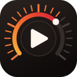

<p align="center">
  
</p>

<h1 align="center">Meter for YouTube</h1>

<p align="center">
  See how much of your day YouTube is really taking — live, on the page.
</p>

A Chrome extension that shows **how much time you've spent today** in real time at the top-right of the YouTube screen. Set an optional daily usage limit to replace YouTube with a quiet break page when it's time to stop.

## What it shows

**On the page** — a top-right overlay with two stacked times:

- **👀 Usage** — total time spent on a YouTube tab (browsing, searching, comments included)
- **🎬  Watch** — time a video is actually playing

The gap between the two is **time leaked into browsing.**

**In the popup** — click the toolbar icon for the trends dashboard:

- Summary tiles for today's usage, today's watch, and daily average usage
- A line chart of usage vs watch across days, so the trend and the leak gap are visible over time
- 7 / 30 / 90-day range toggle

## Daily usage limit

In the popup, choose hours (0–23) and minutes (0–59) while **Daily usage limit**
is off, then turn it on to apply the limit. Choose at least 1 minute. Time
selection is locked while the limit is on; turn it off to change the time. The limit applies to **Usage**, including browsing,
searching, and comments. It starts disabled and is stored on this device only.

When you reach the limit, playback stops and YouTube is replaced by a break page.
The break page does not add usage or watch time. The same limit repeats each day,
and usage resets at local midnight. Increasing the limit above today's usage or
disabling it in the popup takes effect immediately and returns open
break pages to their original YouTube pages. There is no bypass button on the
break page.

## Privacy

All data stays in your own browser and Google account. Nothing is sent to any third party. A backup copy is kept in `chrome.storage.sync` so your history survives a reinstall, and records older than 90 days are cleaned up automatically.

## Languages & theme

- The UI follows your browser's language automatically (English and Korean bundled).
- Light and dark themes are supported on both the overlay and the popup — **Auto** follows your OS setting, or pick **Light** / **Dark** from the popup footer.

## Structure

```
manifest.json      # MV3 config
_locales/          # en (default) + ko translations
src/
  content.js       # overlay render + time tracking
  background.js    # service worker, per-date accumulation
  popup.html       # dashboard layout + styles
  popup.js         # storage read + SVG trend chart
icons/             # 16 / 48 / 128px
```

## Verification

Run `node --test tests/*.test.cjs` for limit, time accounting, and concurrent
storage-write tests. Load the project as an unpacked extension in Chrome to
check the popup, playback interruption, and break-page navigation.
